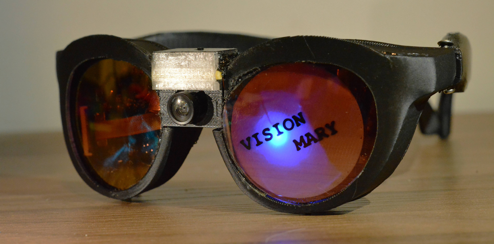
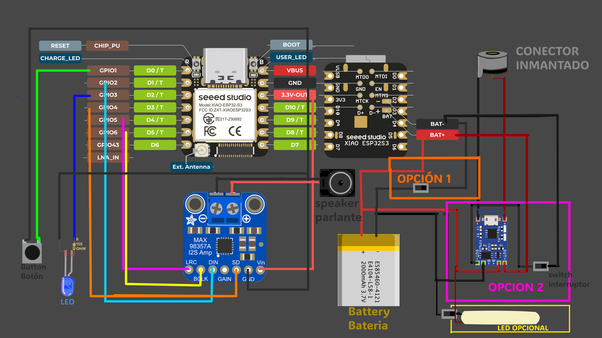

# 👓 Visual Mary — by Arraariatu

Gafas asistivas basadas en **ESP32-S3** que describen lo que ves, responden preguntas sobre tu entorno y guardan fotos de lo que consideras bello.

> Proyecto de arte, tecnología y accesibilidad. **Firmware gratuito (freeware, código cerrado).**



[](https://www.juandmunoz.xyz/vision_mary/)
[](https://github.com/xuanmunoz/visual-mary/releases/latest)

---

##  Video de presentación

<!-- Pega aquí el enlace o el embed cuando el video esté listo -->
_Próximamente._

---

##  Funciones

| Gesto del botón | Qué hace |
|---|---|
| **Clic simple** | Captura una imagen y la describe en voz alta |
| **Doble clic** | Graba una pregunta de audio y la envía junto con la imagen a Gemini para obtener una respuesta específica |
| **Clic prolongado** | Captura una foto de lo que percibes como bello y, si el envío está activado, la sube a la [galería del proyecto](https://www.juandmunoz.xyz/vision_mary/fotos.php) |

Además:

- Configuración por **portal cautivo** (WiFi, volumen, API key, galería y firma).
- Red WiFi **primaria y secundaria**: por ejemplo, el WiFi de casa y el hotspot del celular, para cuando te desplazas.
- Actualizaciones **OTA**.

---

##  Flashear el firmware (sin instalar nada)

1. Conecta el XIAO ESP32-S3 Sense al computador por USB.
2. Abre la página de instalación:

    **https://www.juandmunoz.xyz/vision_mary/**

3. Pulsa el botón de instalar y selecciona el puerto serial del dispositivo.

Requiere **Chrome o Edge en escritorio** (Web Serial). No funciona en celular ni en Firefox/Safari.

### Instalación manual con el `.bin`

Descarga el archivo desde [**Releases**](https://github.com/xuanmunoz/visual-mary/releases/latest) y verifica su integridad:

```bash
# Linux / macOS
sha256sum visual-mary-vX.Y.Z.bin

# Windows (PowerShell)
Get-FileHash visual-mary-vX.Y.Z.bin -Algorithm SHA256
```

El resultado debe coincidir con el SHA-256 publicado en las notas de cada versión.

---

##  Hardware

| Componente | Cant. | Especificaciones |
|---|---|---|
| Seeed Studio XIAO ESP32-S3 Sense | 1 | Incluye cámara y micrófono PDM |
| Amplificador I2S MAX98357A | 1 | Salida de audio |
| Parlante | 1 | Tamaño máximo: 15 mm de alto × 20 mm de ancho × 3,5 mm de grosor |
| Batería LiPo | 1 | Tamaño máximo: 20 mm × 25 mm · Capacidad mínima: 300 mAh |
| Módulo de carga TP4056 | 1 | Salidas a los pads de batería del XIAO |
| Interruptor (switch) | 1 | En GND de la batería: permite cargar sin encender el ESP32 |
| Botón pulsador | 1 | |
| LED | 1 | Indicador de estado |

> Esta versión **no usa tarjeta SD**.

---

##  Pinout



| Función | GPIO | Notas |
|---|---|---|
| Botón | 1 | |
| LED | 3 | |
| I2S LRC / WS (MAX98357A) | 5 | |
| I2S BCLK (MAX98357A) | 6 | |
| I2S DIN (MAX98357A) | 2 | Salida de datos del ESP32 hacia el amplificador |
| SD_MODE / SD del MAX98357A | 4 | Pin de apagado y selección de canal **del amplificador** (no es de tarjeta SD) |
| Micrófono PDM | n/a | Integrado en el Sense |
| Cámara | n/a | Integrada en el Sense |


---

##  Primer uso y configuración

1. Enciende las gafas.
2. Si no hay una red WiFi guardada, se crea una red llamada **`GafasVision-Config`**. Conéctate a ella desde tu celular o computador.
3. Se abre el portal cautivo (si no se abre solo, entra desde el navegador a la dirección que aparece en el portal de tu sistema).
4. Configura:
   - **WiFi primario** y, opcionalmente, **WiFi secundario** (por ejemplo, el hotspot del celular).
   - **Tu propia API key de Gemini.**
   - **Volumen** del parlante.
   - **Envío de fotos a la galería**: actívalo o desactívalo.
   - **Firma** opcional que se añade a las fotos de la galería.
5. Guarda y usa el botón según la tabla de funciones.

>  Tu API key se guarda únicamente en el dispositivo. El firmware no incluye ninguna clave.

---

##  Privacidad

- Con **clic simple** y **doble clic**, las gafas envían **imágenes y audio a la API de Gemini (Google)**, usando tu propia clave. Revisa los términos y la política de datos de Google para tu tipo de cuenta.
- Con **clic prolongado**, y solo si el envío a la galería está activado, la foto se guarda en el servidor del proyecto y se muestra en la [galería pública](https://www.juandmunoz.xyz/vision_mary/fotos.php). Las fotos se almacenan **sin metadatos** (por ejemplo, sin ubicación).
- Puedes **desactivar el envío de fotos** en cualquier momento desde el portal de configuración.
- **No captures personas sin su consentimiento.**
- Para pedir que retiren una foto de la galería, escribe a: TODO (correo o formulario).

##  Aviso importante

Las descripciones y respuestas son generadas por inteligencia artificial y **pueden ser incorrectas o incompletas**. Visual Mary **no es un dispositivo de seguridad ni médico**: no lo uses para decisiones críticas como cruzar una calle, leer medicamentos o confiar en avisos de peligro.

---

## 📄 Licencia

Este firmware se distribuye **gratuitamente y sin el código fuente** bajo los términos del archivo [LICENSE](LICENSE):

- ✅ Uso gratuito
- ✅ Redistribución del `.bin` sin modificar y con atribución
- ❌ No se permite modificarlo, descompilarlo ni hacer ingeniería inversa
- ❌ No se permite su venta
- Se ofrece **sin garantía de ningún tipo**

Este proyecto usa componentes de terceros con sus propias licencias. Ver [THIRD_PARTY_NOTICES.md](THIRD_PARTY_NOTICES.md).

> Es *freeware*, no *open source*: el código fuente es privado.

---

##  Reportar errores y sugerencias

Abre un [Issue](https://github.com/xuanmunoz/visual-mary/issues) e incluye:

- Versión del firmware
- Qué estabas haciendo (clic simple, doble o prolongado)
- Qué pasó y qué esperabas
- Si es posible, el log serial

Para reportar un problema de seguridad, lee [SECURITY.md](SECURITY.md).

---

##  Créditos

Creado por **Arraariatu** (@xuanmunoz) · https://www.juandmunoz.xyz
